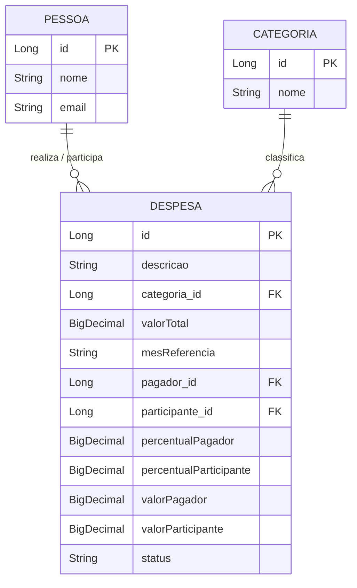
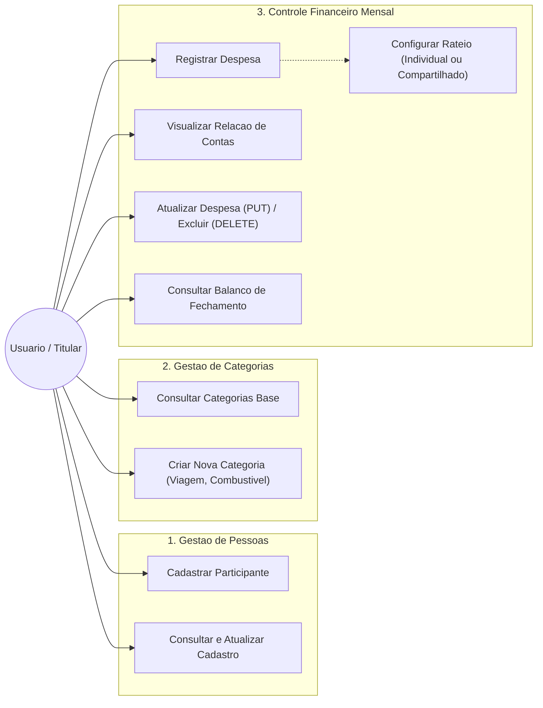
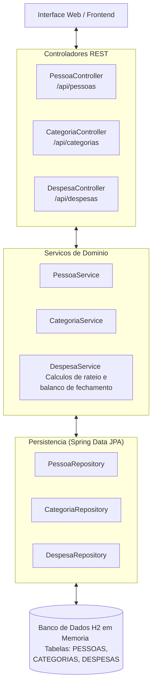

# Sistema de Gestão Financeira Compartilhada e Individual - Backend

API REST desenvolvida em Spring Boot voltada exclusivamente para o controle, acompanhamento e organização de despesas mensais. O sistema atua como uma ferramenta analítica de gestão orçamentária pessoal ou compartilhada, sem qualquer intermediação financeira ou dependência de meios de pagamento.

A solução atende dois formatos de uso:
1. Controle Individual: Acompanhamento de despesas pessoais, organização por categorias customizadas e histórico mensal.
2. Controle Compartilhado (Casal ou Moradia Conjunta): Divisão transparente de contas comuns com definição flexível de rateio (50/50, percentuais proporcionais como 60/40, ou despesa integral) e consolidação do balanço mensal entre os participantes.

O modelo é estruturado em três módulos:
* Participantes: Cadastro das partes envolvidas (uma pessoa para controle pessoal ou duas para controle compartilhado), contendo nome e identificação.
* Categorias: Classificação das contas com opções padrão (Aluguel, Luz, Água, Mercado, Internet) e criação dinâmica de novas categorias (como Viagem, Combustível, Lazer, etc.) via API.
* Despesas Mensais: Lançamentos associados a quem efetuou o pagamento, aplicação das regras de rateio e emissão do demonstrativo de fechamento do mês.

---

## 1. Engenharia de Software: Especificação de Requisitos

Na Engenharia de Software, a separação clara entre requisitos garante o alinhamento técnico e funcional:

* Requisitos Funcionais (RF): Descrevem as ações, cálculos e operações que o sistema executa para atender as necessidades dos usuários.
* Requisitos Não Funcionais (RNF): Definem os critérios de qualidade técnica, arquitetura, segurança, manutenibilidade e desempenho.

### 1.1. Requisitos Funcionais (RF)

| Código | Requisito Funcional | Descrição |
| :--- | :--- | :--- |
| RF01 | Cadastro de Participante | Permitir o registro do nome de cada pessoa que utilizará o sistema. |
| RF02 | Suporte Individual e Compartilhado | Permitir que o sistema opere com apenas uma pessoa cadastrada ou com controle compartilhado. |
| RF03 | Manutenção de Participantes | Permitir a listagem, edição e remoção de pessoas cadastradas. |
| RF04 | Criação Dinâmica de Categorias | Permitir a consulta das categorias existentes e o cadastro de novas categorias (ex: Viagem, Combustível) via API. |
| RF05 | Lançamento de Despesas Mensais | Registrar despesas informando descrição, categoria, valor total, mês de competência e quem realizou o pagamento. |
| RF06 | Regra de Rateio Flexível | Permitir configurar a participação de cada envolvido (100% pessoal, 50/50 ou qualquer percentual customizado). |
| RF07 | Grade Analítica de Contas | Exibir todas as despesas do mês detalhando a cota devida por cada integrante. |
| RF08 | Atualização de Lançamentos (PUT) | Permitir a alteração de valores, percentuais, categoria e status de qualquer despesa cadastrada. |
| RF09 | Remoção de Lançamentos (DELETE) | Permitir a exclusão de títulos lançados indevidamente. |
| RF10 | Balanço de Fechamento do Mês | Demonstrar o total desembolsado por pessoa versus a cota de responsabilidade de cada um, apontando o saldo de fechamento. |

### 1.2. Requisitos Não Funcionais (RNF)

| Código | Requisito Não Funcional | Descrição |
| :--- | :--- | :--- |
| RNF01 | Arquitetura RESTful em Camadas | Separação formal entre Controller, Service, Repository e Model para garantir baixo acoplamento e manutenção facilitada. |
| RNF02 | Banco de Dados em Memória | Armazenamento relacional utilizando H2 Database em memória para agilidade de desenvolvimento e testes. |
| RNF03 | Abstração com Spring Data JPA | Uso de Hibernate/JPA para facilitar futura portabilidade para outros bancos (PostgreSQL, MySQL). |
| RNF04 | Validação de Entrada | Aplicação de regras de integridade com Jakarta Validation (proibição de valores monetários nulos ou negativos). |
| RNF05 | Desempenho Operacional | Tempo de resposta para consultas e gravações inferior a 200 milissegundos. |
| RNF06 | Portabilidade de Build | Execução consistente em qualquer sistema operacional através do script Maven Wrapper integrado ao projeto. |

---

## 2. Diagramas de Engenharia de Software

### 2.1. Modelo Entidade e Relacionamento (MER)



---

### 2.2. Diagrama de Casos de Uso (Use Case)



---

### 2.3. Diagrama de Arquitetura em Camadas



---

## 3. Estrutura do Banco de Dados Relacional

### Tabela: `pessoas`
| Campo | Tipo | Descrição | Exemplo |
| :--- | :--- | :--- | :--- |
| `id` | `Long` | Chave primária autoincremento | `1` |
| `nome` | `String` | Nome do integrante financeiro | `"Helena Colucci"` |
| `email` | `String` | Endereço eletrônico de contato (opcional) | `"helena@email.com"` |

### Tabela: `categorias`
| Campo | Tipo | Descrição | Exemplo |
| :--- | :--- | :--- | :--- |
| `id` | `Long` | Chave primária autoincremento | `1` |
| `nome` | `String` | Nome da categoria | `"Aluguel"`, `"Viagem"`, `"Combustível"` |

### Tabela: `despesas`
| Campo | Tipo | Descrição | Exemplo |
| :--- | :--- | :--- | :--- |
| `id` | `Long` | Chave primária autoincremento | `1` |
| `descricao` | `String` | Identificação do título lançado | `"Combustível Viagem Litoral"` |
| `categoria_id` | `Long (FK)` | Relacionamento com a tabela categorias | `4` |
| `valorTotal` | `BigDecimal` | Valor integral da despesa | `300.00` |
| `mesReferencia` | `String` | Mês e ano de competência | `"10/2026"` |
| `pagador_id` | `Long (FK)` | Integrante que efetuou o pagamento | `1` |
| `participante_id` | `Long (FK)` | Segundo envolvido (se compartilhado) | `2` |
| `percentualPagador` | `BigDecimal` | Proporção de responsabilidade do pagador | `50.00` (ou 100 se individual) |
| `percentualParticipante`| `BigDecimal` | Proporção do segundo participante | `50.00` (ou 0 se individual) |
| `valorPagador` | `BigDecimal` | Montante devido pelo pagador | `150.00` |
| `valorParticipante` | `BigDecimal` | Montante devido pelo participante | `150.00` |
| `status` | `String` | Situação da conta | `"PAGO"`, `"PENDENTE"` |

---

## 4. Endpoints da API REST

Base URL: `http://localhost:8080/api`

### 4.1. Recursos de Participantes (`/pessoas`)
| Método | Endpoint | Descrição |
| :--- | :--- | :--- |
| `GET` | `/pessoas` | Lista os participantes registrados |
| `POST` | `/pessoas` | Registra um participante |
| `PUT` | `/pessoas/{id}` | Atualiza informações de um participante |
| `DELETE` | `/pessoas/{id}` | Remove um participante |

### 4.2. Recursos de Categorias (`/categorias`)
| Método | Endpoint | Descrição |
| :--- | :--- | :--- |
| `GET` | `/categorias` | Lista as categorias cadastradas |
| `POST` | `/categorias` | Cadastra nova categoria personalizada (Viagem, Combustível, etc.) |
| `DELETE` | `/categorias/{id}` | Remove uma categoria sem vínculos ativos |

### 4.3. Recursos de Despesas (`/despesas`)
| Método | Endpoint | Descrição |
| :--- | :--- | :--- |
| `GET` | `/despesas?mes=10/2026` | Lista todas as contas do mês com a divisão aplicada |
| `GET` | `/despesas/balanco?mes=10/2026` | Retorna o balanço consolidado e o saldo de fechamento entre as partes |
| `POST` | `/despesas` | Cadastra despesa com pagador e percentuais definidos |
| `PUT` | `/despesas/{id}` | Atualiza qualquer informação da despesa cadastrada |
| `DELETE` | `/despesas/{id}` | Remove uma despesa |

---

## 5. Exemplos de Payloads (JSON)

### 5.1. Cadastro de Categoria Personalizada (`POST /categorias`)
Requisição:
```json
{
  "nome": "Combustível"
}
```
Resposta (201 Created):
```json
{
  "id": 8,
  "nome": "Combustível"
}
```

### 5.2. Cadastro de Participante (`POST /pessoas`)
Requisição:
```json
{
  "nome": "Helena Colucci",
  "email": "helena@email.com"
}
```
Resposta (201 Created):
```json
{
  "id": 1,
  "nome": "Helena Colucci",
  "email": "helena@email.com"
}
```

### 5.3. Cadastro de Despesa Compartilhada (`POST /despesas`)
Requisição:
```json
{
  "descricao": "Abastecimento Estrada",
  "categoriaId": 8,
  "valorTotal": 300.00,
  "mesReferencia": "10/2026",
  "pagadorId": 1,
  "participanteId": 2,
  "percentualPagador": 50.00,
  "percentualParticipante": 50.00,
  "status": "PAGO"
}
```
Resposta (201 Created):
```json
{
  "id": 1,
  "descricao": "Abastecimento Estrada",
  "categoria": {
    "id": 8,
    "nome": "Combustível"
  },
  "valorTotal": 300.00,
  "mesReferencia": "10/2026",
  "pagador": {
    "id": 1,
    "nome": "Helena Colucci"
  },
  "participante": {
    "id": 2,
    "nome": "Otavio Faria"
  },
  "valorPagador": 150.00,
  "valorParticipante": 150.00,
  "status": "PAGO"
}
```

### 5.4. Consulta de Balanço de Fechamento (`GET /despesas/balanco?mes=10/2026`)
Resposta:
```json
{
  "mesReferencia": "10/2026",
  "totalGeral": 4800.00,
  "totalDevidoHelena": 2650.00,
  "totalPagoHelena": 3000.00,
  "totalDevidoOtavio": 2150.00,
  "totalPagoOtavio": 1800.00,
  "saldoDevedor": "Otavio Faria",
  "saldoCredor": "Helena Colucci",
  "diferencaFechamento": 350.00
}
```

---

## 6. Proposta de Interface Frontend (2 Telas)

### 6.1. Tela 1 - Gestão de Participantes
```text
+-------------------------------------------------------------------------------------+
| SISTEMA DE FINANCAS                [ Participantes (Ativo) ]     [ Despesas ]       |
+-------------------------------------------------------------------------------------+
|                                                                                     |
|  REGISTRO DE PARTICIPANTE                                                           |
|  +--------------------------------------------------------------------------------+ |
|  | Nome Completo: [ Helena Colucci         ]   E-mail: [ helena@email.com       ] | |
|  | [ Gravar Registro ]                                                            | |
|  +--------------------------------------------------------------------------------+ |
|                                                                                     |
|  INTEGRANTES REGISTRADOS                                                            |
|  +--------------------------------------------------------------------------------+ |
|  | Helena Colucci                                                                 | |
|  | Identificador: 1                                   [ Editar ]    [ Excluir ]   | |
|  +--------------------------------------------------------------------------------+ |
|  | Otavio Faria (opcional para uso compartilhado)                                 | |
|  | Identificador: 2                                   [ Editar ]    [ Excluir ]   | |
|  +--------------------------------------------------------------------------------+ |
|                                                                                     |
|                         [ Avancar para Despesas do Mes -> ]                         |
+-------------------------------------------------------------------------------------+
```

### 6.2. Tela 2 - Gestão Financeira Mensal
```text
+-----------------------------------------------------------------------------------------------+
| SISTEMA DE FINANCAS         [ Participantes ]   [ Despesas (Ativo) ]        [ Periodo: 10/2026 ]|
+-----------------------------------------------------------------------------------------------+
|                                                                                               |
|  RESUMO DO PERIODO                                                                            |
|  +----------------------------+-------------------------------+-----------------------------+ |
|  | Total de Despesas          | Cota: Helena                  | Cota: Otavio (ou Individual)| |
|  | R$ 4.800,00                | R$ 2.650,00                   | R$ 2.150,00                 | |
|  +----------------------------+-------------------------------+-----------------------------+ |
|                                                                                               |
|  BALANCO DE FECHAMENTO (CONTROLE COMPARTILHADO)                                               |
|  +------------------------------------------------------------------------------------------+ |
|  | Desembolso realizado por Helena: R$ 3.000,00 (Cota justa: R$ 2.650,00)                    | |
|  | Desembolso realizado por Otavio: R$ 1.800,00 (Cota justa: R$ 2.150,00)                    | |
|  | Fechamento: Helena pagou R$ 350,00 acima de sua cota; Otavio pagou R$ 350,00 abaixo.     | |
|  +------------------------------------------------------------------------------------------+ |
|                                                                                               |
|  FORMULARIO DE LANCAMENTO                                                                     |
|  +------------------------------------------------------------------------------------------+ |
|  | Descricao:   [ Abastecimento Viagem        ]   Categoria: [ COMBUSTIVEL               v ]| |
|  |                                                           [ + Nova Categoria ]           | |
|  | Valor (R$):  [ 300.00                      ]   Pagador:   [ Helena                    v ]| |
|  | Tipo/Rateio: [ Compartilhado: Helena 50% (R$ 150,00) | Otavio 50% (R$ 150,00)          v ]| |
|  | Status:      [ PAGO                      v ]   [ Gravar Despesa ] [ Limpar ]              | |
|  +------------------------------------------------------------------------------------------+ |
|                                                                                               |
|  GRADE ANALITICA DE DESPESAS                                                                  |
|  +----------------------+-------------+------------+----------+----------+--------+---------+ |
|  | Descricao            | Categoria   | Total (R$) | Helena   | Otavio   | Pagador| Acoes   | |
|  +----------------------+-------------+------------+----------+----------+--------+---------+ |
|  | Aluguel              | ALUGUEL     |   2.000,00 | 1.200,00 |   800,00 | Helena | [E] [X] | |
|  | Energia Eletrica     | LUZ         |     280,00 |   140,00 |   140,00 | Otavio | [E] [X] | |
|  | Abastecimento Mercado| MERCADO     |     850,00 |   425,00 |   425,00 | Helena | [E] [X] | |
|  | Conexao Internet     | INTERNET    |     120,00 |    60,00 |    60,00 | Otavio | [E] [X] | |
|  | Abastecimento Viagem | COMBUSTIVEL |     300,00 |   150,00 |   150,00 | Helena | [E] [X] | |
|  | Curso de Especializ. | EDUCACAO    |     450,00 |   450,00 |     0,00 | Helena | [E] [X] | |
|  +----------------------+-------------+------------+----------+----------+--------+---------+ |
|  Legenda de acoes: [E] Editar  |  [X] Excluir                                                 |
+-----------------------------------------------------------------------------------------------+
```

---

## 7. Instruções de Execução

### 7.1. Requisitos de Ambiente
* Java Development Kit (JDK) versão 25

### 7.2. Inicialização do Servidor
No diretório raiz do projeto, execute:
```powershell
.\mvnw.cmd spring-boot:run
```

A API estará disponível em: `http://localhost:8080/api`

### 7.3. Acesso ao Console do Banco de Dados H2
* URL do Console: `http://localhost:8080/h2-console`
* Driver Class: `org.h2.Driver`
* JDBC URL: `jdbc:h2:mem:financasdb`
* User Name: `sa`
* Password: (deixar vazio)
